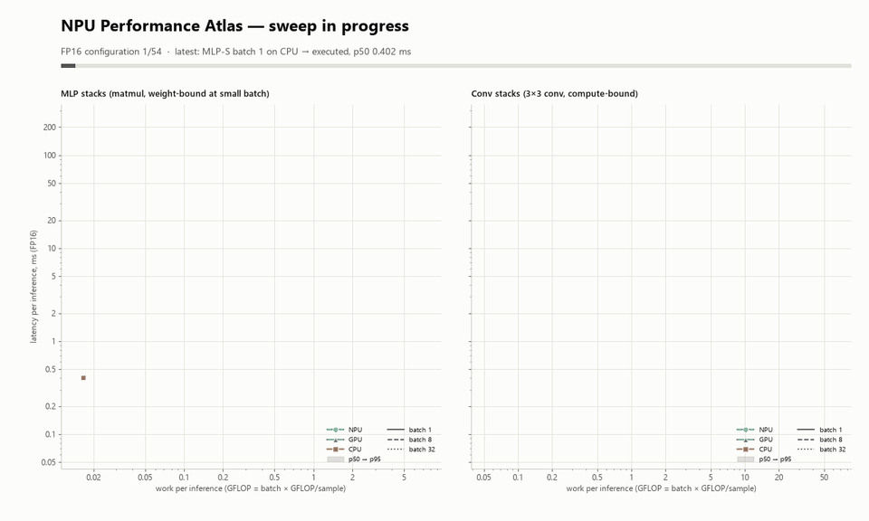
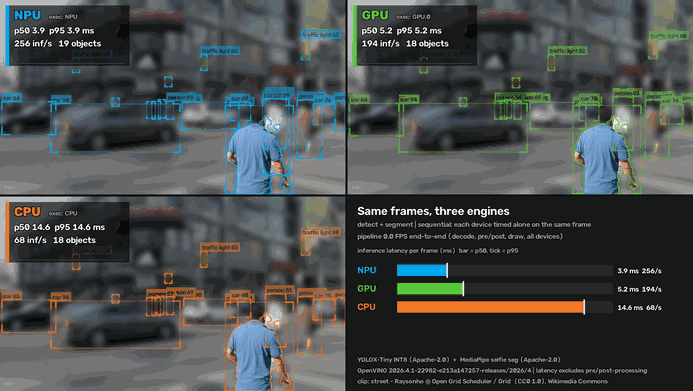
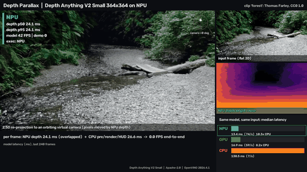
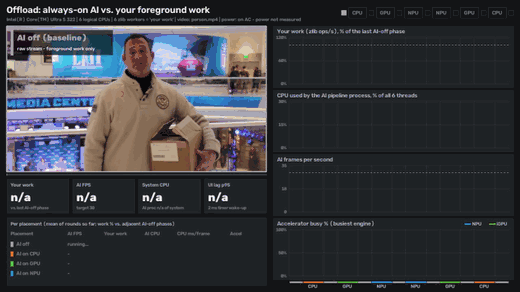
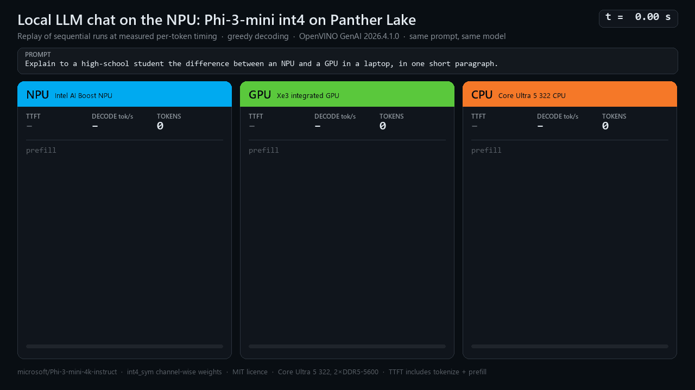

# Panther Lake AI Lab

Reproducible CPU, GPU, and NPU experiments for Intel Core Ultra Series 3 (Panther Lake), initially on a Lenovo IdeaPad 5 2-in-1 15IPH11 with Core Ultra 5 322.

## Goals

- Identify CPU, Xe3 integrated GPU, and NPU hardware and drivers.
- Test OpenVINO, ONNX Runtime, Windows ML, Ollama, llama.cpp and Intel AI Playground.
- Verify *actual execution devices* instead of assuming acceleration.
- Compare latency, throughput, RAM, temperature, power and battery usage.
- Publish reproducible results across driver, BIOS and RAM configurations.

## Quick start (Windows PowerShell)

Prerequisites: Python 3.12 (`winget install -e --id Python.Python.3.12`, which includes the `py` launcher), plus current Intel NPU and graphics drivers. See **[Driver setup](docs/DRIVER_SETUP.md)** for the minimum versions, download links and install steps. OpenVINO 2026.4 needs NPU driver 32.0.100.5540 or later on Core Ultra Series 3.

Clone this repository and run:

```powershell
powershell -ExecutionPolicy Bypass -File .\hardware\inventory.ps1
py -3 -m venv .venv
.\.venv\Scripts\python.exe -m pip install -r requirements.txt
.\.venv\Scripts\python.exe scripts\detect_devices.py
.\.venv\Scripts\python.exe scripts\benchmark_openvino.py --device CPU
```

Only try `--device GPU` or `--device NPU` after device discovery confirms them. A device being detected does not establish that a model can compile or execute on it.

## Methodology

Record Windows build, firmware, CPU/GPU/NPU drivers, runtime version, plugged-in status, power mode, RAM configuration, model and precision. Warm up before timed runs and use identical inputs. The included matrix multiplication test is a basic inference smoke test, **not** an LLM benchmark.

## Privacy

Review hardware inventories before publishing; generated results are excluded by default.

See [compatibility matrix](docs/compatibility-matrix.md). Contributions welcome. MIT licensed.

## Project management

- [Full project plan](docs/PROJECT_PLAN.md)
- [Kanban planning board](docs/PROJECT_BOARD.md)
- [GitHub Issues](https://github.com/jcallinan/panther-lake-ai-lab/issues)

## Academic research and conference preparation

- [Master's-level paper draft](docs/PAPER_DRAFT.md)
- [Conference readiness roadmap](docs/CONFERENCE_ROADMAP.md)

These are research-stage documents; no experimental findings or conference acceptance are claimed.

## First test session

Before changing drivers or hardware, follow the [first laptop test protocol](docs/FIRST_TEST_SESSION.md) and preserve a sanitized baseline. The [Kanban board](docs/PROJECT_BOARD.md) now tracks all 16 issues, including academic publication work.

## NPU showcase examples

Each example runs the same workload on NPU, GPU and CPU. It reports the device that actually executed the work (`EXECUTION_DEVICES`) and never falls back to another device silently. Timings were measured on a Core Ultra 5 322 and depend on the driver version. See each example's README for methodology and caveats.

| Example | What it shows | Preview |
|---|---|---|
| [Performance Atlas](examples/perf_atlas/) | 162-configuration sweep (size × batch × precision × device), with p50/p95 and numpy-verified correctness, showing where the NPU wins and where it doesn't |  |
| [Vision side-by-side](examples/vision_side_by_side/) | Object detection plus background blur on the same video, NPU vs GPU vs CPU |  |
| [Depth Parallax](examples/depth_parallax/) | Per-frame monocular depth on the NPU turns flat video into an orbiting 3D point cloud |  |
| [Offload dashboard](examples/offload_dashboard/) | Always-on AI on CPU, then GPU, then NPU, measuring how much foreground CPU work survives each placement |  |
| [LLM chat](examples/llm_chat/) | Phi-3-mini int4 chatting on the NPU; replay of the three devices at measured token timings |  |

Setup:
```powershell
.\.venv\Scripts\python.exe -m pip install -r requirements.txt -r requirements-examples.txt
.\.venv\Scripts\python.exe scripts\fetch_models.py               # ~2 GB, mostly the LLM; --only vision|depth|llm
.\.venv\Scripts\python.exe -m examples.vision_side_by_side      # each example: python -m examples.<name>
```
Models download to `models/`, and stock clips download automatically to `assets/clips/` on first use. Both are gitignored; clip licences are listed in [assets/CLIPS_ATTRIBUTION.md](assets/CLIPS_ATTRIBUTION.md). To re-run every benchmark and re-record all media one at a time, use `scripts\record_all.ps1`. Hardware background: [docs/PANTHER_LAKE_REFERENCE.md](docs/PANTHER_LAKE_REFERENCE.md).

## NPU experiment suite

- [Ten proposed NPU projects and research methodology](docs/NPU_EXPERIMENT_SUITE.md)
- [NPU matrix compatibility and latency sweep](scripts/npu_matrix_sweep.py)
- [Synthetic anomaly scoring demonstration](scripts/npu_anomaly_demo.py)
- [NPU research issues #17–21](https://github.com/jcallinan/panther-lake-ai-lab/issues)

After installing dependencies, run:

```powershell
.\.venv\Scripts\python.exe scripts\npu_matrix_sweep.py --devices CPU GPU NPU
.\.venv\Scripts\python.exe scripts\npu_anomaly_demo.py --devices CPU GPU NPU
```

These are preliminary compatibility and latency tests. No device execution or NPU acceleration has been verified on the physical laptop yet.
