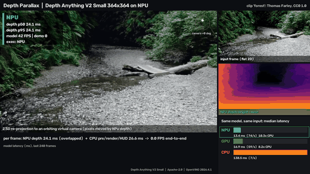

# Depth Parallax: flat video, orbiting 3D, on the NPU



Every frame of an ordinary 2D video goes through **Depth Anything V2 Small** (monocular relative depth) on the
**Intel AI Boost NPU**. The CPU then lifts the frame into a 3D point cloud using that depth and re-renders it
from a slowly orbiting virtual camera. The flat clip gains a 3D "wiggle": near rocks and ferns slide against
the far canyon. The composite shows the input frame, the colourised NPU depth (bright = near), and the
re-projected hero view. A HUD shows NPU latency, and an inset compares the same model on NPU, GPU and CPU.

**Why the NPU:** per-frame depth is the expensive part. On this Core Ultra 5 322, the 364x364 model takes about
13 ms on the NPU. The CPU takes 170-245 ms, so the NPU is roughly 13-16x faster. The integrated GPU (2 Xe3
cores) takes 19-29 ms. With the NPU doing inference, the CPU is free to do the 3D rendering.

## Run

```powershell
.venv\Scripts\python.exe -m examples.depth_parallax                          # default clip 'forest', live window (q/Esc quits)
.venv\Scripts\python.exe -m examples.depth_parallax --source drive           # any clip from examples.common.clips, a video file, or a webcam index
.venv\Scripts\python.exe -m examples.depth_parallax --image photo.jpg        # 3D-photo "Ken Burns" mode for a still image
.venv\Scripts\python.exe -m examples.depth_parallax --record --no-display    # writes media/depth_parallax.gif + media/mp4/depth_parallax.mp4
.venv\Scripts\python.exe -m examples.depth_parallax --device GPU --no-compare
```

| Flag | Meaning |
|---|---|
| `--device` | Device for the live model (default `NPU`). The demo never falls back to another device: if compilation fails, it exits with the error. |
| `--compare` / `--no-compare` | Run a short startup benchmark of the same model and input on NPU, GPU and CPU for the inset (on by default; CPU adds about 5 s). |
| `--record`, `--duration` | Record the composite. Duration defaults to 12 s when recording or headless. |
| `--orbit` | Multiplier for the camera orbit amplitude (default 1.0: about ±5° yaw). |
| `--output` | Results JSON, default `benchmarks/results/depth_parallax.json`. It holds per-device latency stats, `compile_s` with a cold/warm cache flag, `EXECUTION_DEVICES`, frame count, and the clip with its licence. |
| `--size` | Model input side, a multiple of 14 (default 364; 518 also works on the NPU at about 25 ms). |

The first NPU compile takes 15-35 s. The blob is cached in `models/npucache` (gitignored), and later starts
load it in under 0.1 s. A splash screen says "compiling" while this happens.

## Measured (this laptop, 2026-11-11, other demos sharing the NPU and CPU, so numbers are noisy)

| | NPU | GPU | CPU |
|---|---|---|---|
| Startup benchmark, median ms (364x364) | 12.8 | 19.3-28.7 | 172-244 |
| Compile, cold / cached | 17.2 s / 0.07 s | 5.7 s / 2.5 s | 5-8 s (no cache) |

Live run on the `forest` clip with recording on:
- NPU latency per frame: p50 17.4 ms, p95 19.0 ms. This is `InferRequest.latency`. It is higher than the
  isolated benchmark because the host thread is busy at the same time.
- Host work per frame: 36 ms. That covers preprocessing, depth normalisation, the 3D re-projection (19 ms) and the HUD.
- End to end: 25-30 FPS, or about 40 FPS on simpler content without recording.

Inference of frame N+1 overlaps with rendering of frame N. The demo is therefore **CPU-render bound, not NPU
bound**, and the HUD reports the two separately.

## How the 3D view is made (`render.py`)

1. Normalise inverse depth to [0, 1] using percentiles. The percentiles are smoothed with an EMA so brightness doesn't flicker.
2. Lift pixels to 3D with Z = 1/(0.25 + 0.75·d) and a 55° pinhole camera. Rotate the cloud (yaw/pitch) about
   the median scene depth, and add a gentle dolly.
3. Forward-splat the new depth with a z-buffer at half resolution. Close cracks with a grey morphological opening.
   Fill disocclusions from the background side using a multi-scale max filter.
4. Invert the exact 3D transform per target pixel and `cv2.remap` the full-resolution colour frame. This keeps
   edges crisp. Revealed regions show stretched background and are slightly dimmed. A light fog darkens far regions.

## Caveats

- The depth is relative and monocular (affine-invariant inverse depth). The 3D is plausible, not metric, and
  objects touching the frame edge or very close to the camera can smear. The dashcam clip's mirror and A-pillar
  are an example, which is why `forest` is the default clip.
- `--image` repeats inference on the same still every frame so the HUD shows a live device rate.
- Timings vary with power mode and with whatever else is using the NPU or CPU.

## Licences and attribution

- Model: [onnx-community/depth-anything-v2-small](https://huggingface.co/onnx-community/depth-anything-v2-small), Apache-2.0
  (Depth Anything V2, Yang et al. 2024).
- Footage in the GIF: "Fern Canyon in Prairie Creek Redwoods State Park" by Thomas Farley, CC0 1.0, via Wikimedia Commons.
  All clips and their licences are listed in [assets/CLIPS_ATTRIBUTION.md](../../assets/CLIPS_ATTRIBUTION.md).
