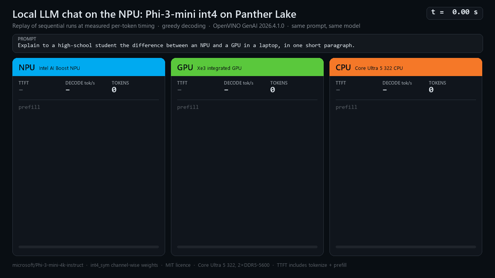
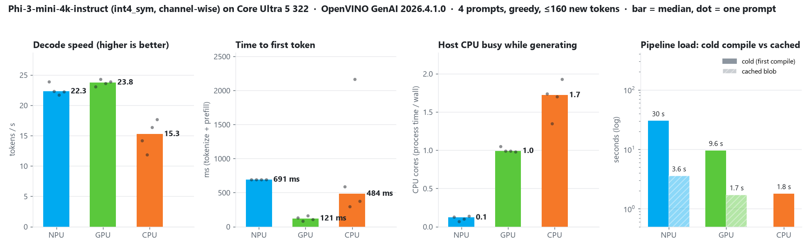

# Local LLM chat on the NPU

A 3.8B-parameter chat model (Microsoft Phi-3-mini, int4) running **entirely on the Intel AI Boost NPU** of a
Core Ultra 5 322 (Panther Lake) laptop, with OpenVINO GenAI. Tokens stream into the terminal as they are generated,
and a benchmark mode runs the same prompts on the NPU, CPU and iGPU so the three can be compared.



The video is a **replay of sequential runs at measured timing**. Each device ran on its own, one after another,
never concurrently. Every token appears at the moment it was actually streamed, measured from that run's
`generate()` call. Static chart: [`media/llm_chat.png`](../../media/llm_chat.png).



## How to run

```powershell
.venv\Scripts\python.exe -m examples.llm_chat                    # interactive chat on the NPU
.venv\Scripts\python.exe -m examples.llm_chat --device CPU       # ... or CPU / GPU
.venv\Scripts\python.exe -m examples.llm_chat --bench            # 4 fixed prompts on NPU, CPU, GPU (sequential)
.venv\Scripts\python.exe -m examples.llm_chat --bench --cold     # clear NPU/GPU compile caches first (times a cold start)
.venv\Scripts\python.exe -m examples.llm_chat --render           # video + chart from benchmarks/results/llm_chat.json
.venv\Scripts\python.exe -m examples.llm_chat --bench --devices NPU CPU --render
```

The model must be in `models/phi-3-mini-4k-instruct-int4-cw-ov` (about 2.1 GB), for example:

```powershell
.venv\Scripts\huggingface-cli.exe download OpenVINO/Phi-3-mini-4k-instruct-int4-cw-ov --local-dir models\phi-3-mini-4k-instruct-int4-cw-ov
```

**First run on the NPU.** The NPU compiles the model once, which took about 1 to 3.5 minutes on this laptop
(see below). The compiled blob is cached in `models/npucache/` (gitignored, about 240 MB), and later starts load in
about 2.6 s. The chat prints whether the cache was cold or warm, and how long loading took. GPU uses
`models/gpucache/` the same way. CPU needs no compile step.

**Chat commands:** `/reset` clears the history, `/exit` quits. Ctrl+C stops a reply. After each reply a stats line
shows the device, prompt tokens, time to first token (TTFT), decode tok/s, generated tokens and how many host CPU
cores were busy.

## What it measures

* The prompt is formatted with the model's **own chat template** (`Tokenizer.apply_chat_template`, giving Phi-3's
  `<|user|> … <|end|><|assistant|>`). Special tokens are stripped when decoding (`skip_special_tokens=True`).
* A `StreamerBase` subclass timestamps **every token** (`time.perf_counter`) and decodes the text incrementally.
* **TTFT** runs from the `generate()` call to the first streamed token, so it includes tokenization and prefill.
  **Decode tok/s** is `(n − 1) / (t_last − t_first)`. OpenVINO GenAI's own `perf_metrics` values (TTFT, TPOT,
  throughput) are recorded alongside.
* **Host CPU busy** is the process CPU time divided by wall time during `generate()`. It is the evidence for *where*
  the work ran. `LLMPipeline` does not expose the compiled model's `EXECUTION_DEVICES`. The NPU pipeline fails
  instead of falling back, and its run keeps about 0.14 CPU cores busy, against about 2 cores for the CPU run.
* `--bench`: greedy decoding, up to 160 new tokens, one warm-up generation, 4 prompts (explain NPU vs GPU to a
  student, a haiku about Panther Lake, summarize a paragraph, a Python Fibonacci function). For each device the
  pipeline is loaded twice: once for the cold or cached first load, then a reload to time a warm cache start.
* `benchmarks/results/llm_chat.json` holds versions, model id, licence and quantization (read from the IR's
  `rt_info`), power source, load times (cold and cached), per-prompt TTFT, tok/s, prompt tokens, the output text,
  and per-token timestamps and text.
* `--render` writes `media/llm_chat.gif` (< 5 MB, full 1280×720, one shared palette so only changed pixels are
  stored), `media/mp4/llm_chat.mp4` (gitignored) and `media/llm_chat.png`. `--race-prompt` selects which prompt
  the video replays.

## Results on this machine

Clean run, 2026-11-12, NPU driver 32.0.100.5540 (graphics driver 32.0.101.9175, OpenVINO / GenAI 2026.4.1), devices
run one at a time on an otherwise idle laptop on AC power. Values are medians over the 4 prompts.

| Device | Decode tok/s | TTFT | Load: first (cold compile) | Load: cached | Host CPU busy |
|---|---|---|---|---|---|
| NPU (AI Boost) | 21.6 (21.1–23.0) | 698 ms | 29.2 s | 2.6 s | **0.14 cores** |
| **GPU** (Xe3 iGPU) | **21.8** (21.7–22.0) | **103 ms** | 5.6 s | 1.75 s | 1.02 cores |
| CPU | 19.1 (16.9–19.5) | 476 ms (1.7 s for a 102-token prompt) | n/a | 1.3 s (no compile) | 1.96 cores |

* **Decode speed is a near tie, so the NPU's advantage is CPU cost.** The GPU is marginally ahead on decode
  (21.8 vs 21.6 tok/s) and the CPU is about 12 % behind (19.1). The NPU does it with 0.14 CPU cores busy, against
  1.02 for the GPU and 1.96 for the CPU, i.e. about 7× less than the GPU and 14× less than the CPU.
* **The GPU has by far the best TTFT** (prefill is compute-bound). The NPU's TTFT stays at about 0.7 s whatever the
  prompt length (16 to 102 tokens), which is consistent with the NPU running a fixed-shape (static) prefill graph.
* **The compile cache helps most on the NPU.** The first (cold) NPU load took 29.2 s, against 5.6 s on the GPU.
  Both load from cache in under 3 s. (The GPU cold load took 228 s in the preliminary run, which also depends on the
  compile-cache state.) An earlier log from the clean-run session showed a 30.2 s NPU first load labelled "cached"; it
  was really a cold compile, because another example had just written a blob to the shared NPU cache and the cache
  check misfired. That is fixed in `llm.py`, and the JSON now labels this load `cold`.
* The CPU varies most because it competes with everything else on the machine (TTFT 286 ms to 1.7 s across prompts).
  The preliminary run, with other jobs running, gave 11.5 tok/s on the CPU.
* For comparison, the asymmetric-int4 Qwen3-0.6B (6× fewer parameters) gets about 31 tok/s on the CPU. It cannot
  run on the NPU (see below).

## Why symmetric int4 matters on the NPU

The NPU LLM pipeline (NPUW) compiles the model into fixed-shape prefill and decode graphs, and it supports int4
weights only in **symmetric** form: channel-wise (`group_size = -1`, as in this model, `int4_sym` per the IR's
NNCF `rt_info`) or symmetric grouped. This repo's `qwen3-0.6b-int4-ov` is `INT4_ASYM` with group size 128. It runs on
CPU (31 tok/s) and GPU, but its NPU compile hung for over 20 minutes. Look for OpenVINO-org models whose names end in
`-int4-cw-ov`, or export with `optimum-cli export openvino --weight-format int4 --sym --group-size -1`.
(The upstream model card says `int4_asym`, but the IR's own `rt_info` says `int4_sym`, `group_size -1`.)

The NPU pipeline is compiled for `MAX_PROMPT_LEN=1024` and `MIN_RESPONSE_LEN=256`. In chat mode the oldest turns
are dropped when the templated history would exceed 1024 tokens.

## Memory bandwidth sets the speed

Generating each token reads essentially all the weights: about 2.0 GB of int4 weights plus scales. Two channels of
DDR5-5600 give a theoretical peak of about 90 GB/s, and the NPU, iGPU and CPU all share it. That puts a ceiling of
roughly 40 tok/s on any device, and real kernels reach only part of the peak. So the three devices come out within
about 15 % of each other on decode (19.1 to 21.8 tok/s), unlike compute-bound vision models. The NPU's advantages
here are that it keeps the CPU free (0.14 cores busy, against 1.02 for the GPU and 1.96 for the CPU) and runs at low
power. TTFT (prefill) is compute-bound, so the gaps there are
larger.

## Caveats

* **Concurrent load.** These numbers come from a sequential run on an idle machine; other processes using the NPU
  or GPU would perturb them. Power state (AC or battery, Windows power mode) changes them a lot, and the JSON records `meta.power`.
* **Output quality.** Channel-wise int4 costs Phi-3-mini some accuracy. Even under greedy decoding, the outputs show
  glitches (e.g. `that'Delta-Eigen-…"`, `range(2, n + libc_a_1, 1)`). Different devices can produce different text
  for the same prompt because their kernels accumulate in different precisions. Group-wise int4 or int8 weights
  improve quality at the cost of speed and size.
* Cold-compile time varies (29 s in the clean run; 62 s to 204 s in the preliminary runs on the older driver, with
  other jobs running). The NPU driver, the compile-cache state and the contention on the machine all affect it. `--cold` deletes only this example's cached blobs.
* Licence: Phi-3-mini-4k-instruct is **MIT** (Microsoft). The OpenVINO IR is from
  [OpenVINO/Phi-3-mini-4k-instruct-int4-cw-ov](https://huggingface.co/OpenVINO/Phi-3-mini-4k-instruct-int4-cw-ov).
