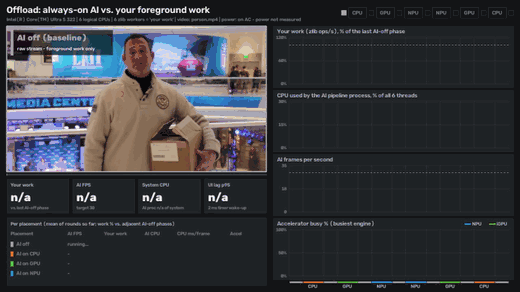

# Offload dashboard: always-on AI vs. your foreground work

**Story:** run always-on AI on the NPU and your CPU stays free for the work you are actually doing.

This demo runs one continuous AI workload: video-call style background blur plus object detection on a video
stream, paced to 30 FPS. It runs the workload on the **CPU**, then the **GPU**, then the **NPU**. The whole time, a
fixed CPU-bound "user work" job runs in the foreground. A live dashboard shows how fast the AI runs, how much of your
own work still gets done, and who is using the CPU.



Static summary: [`media/offload_dashboard.png`](../../media/offload_dashboard.png) · raw numbers:
`benchmarks/results/offload_dashboard.json`.

## Run

```powershell
.venv\Scripts\python.exe -m examples.offload_dashboard                       # live window, 15 s per phase
.venv\Scripts\python.exe -m examples.offload_dashboard --no-display --record  # headless, writes GIF + MP4
.venv\Scripts\python.exe -m examples.offload_dashboard --devices NPU CPU --phase-seconds 10
```

| Flag | Default | Meaning |
|---|---|---|
| `--phase-seconds` | 15 | length of each phase; the first `--settle` (2) seconds of each phase are left out of the stats |
| `--devices` | `CPU GPU NPU` | AI placements to run, in this order |
| `--record` | off | writes `media/offload_dashboard.gif` (sped up to about 20 s, under 5 MB) and `media/mp4/offload_dashboard.mp4` (real time) |
| `--no-display` | off | headless (no OpenCV window) |
| `--output` | `benchmarks/results/offload_dashboard.json` | full results: config, compile info, per-phase means, every 0.5 s sample |
| `--fg-workers` | logical CPUs − 2 (4) | number of foreground worker processes |
| `--target-fps` | 30 | pacing target for the AI pipeline |
| `--clip` | `person`, else `street` | stock clip from `examples/common/clips.py`, or a path. Falls back to a synthetic scene |
| `--no-rebaseline` | off | skip the closing AI-off phase |
| `--snapshot-dir` | none | save one live frame from the NPU phase and the summary frame as PNG files |

Press `q` or `Esc` in the window to stop early.

## Phases

1. **AI off (start)**: foreground work only. This is the baseline.
2. **AI on CPU**, 3. **AI on GPU**, 4. **AI on NPU**: the same pipeline, with both models compiled for that device.
5. **AI off (end)**: a second baseline. Foreground "% retained" is measured against the **mean of both baselines**,
   which absorbs slow drift from heat and turbo. `baseline.drift_pct` in the JSON shows how much the two baselines
   differ.

All models are compiled on every device **before** the foreground load starts. If a device fails to compile, its
phase is marked `compile failed / not available` and skipped. The demo **never** runs that phase on another device
instead. The JSON records `EXECUTION_DEVICES` for every compiled model.

## How to read the dashboard

* **Left:** the processed video, with a badge for the current device. Below it are tiles for the last ~2 s:
  foreground work as a % of baseline, AI FPS, system CPU, and UI lag. Under the tiles is a table that fills in as each
  phase finishes.
* **Right:** line charts across the whole run, coloured by placement (grey = AI off, orange = CPU, green = GPU,
  blue = NPU):
  1. foreground work as a % of baseline (dashed line = 100 %)
  2. CPU used by the AI process
  3. AI FPS (dashed line = target)
  4. how busy the NPU and iGPU are (busiest engine)
* **End:** bar charts of "foreground work retained" and "AI FPS" for each placement, plus a one-line takeaway per
  placement.

## Methodology

* **AI workload** (`workers.ai_process`, its own process). For each 640×360 frame:
  * MediaPipe selfie segmentation at 256×256 and YOLOX-tiny INT8 at 416×416, both Apache-2.0, called synchronously
    one after the other.
  * Input normalisation (u8→f32, BGR→RGB, mean/scale) is built into both models with OpenVINO `PrePostProcessor`,
    so it runs on whichever device runs the model.
  * The CPU still resizes the inputs, blurs the background and blends it with the mask (`cv2.blendLinear`), runs NMS,
    and draws the boxes. This happens in **every** placement and is reported as `prepost_ms`.
  * Frames are paced to `--target-fps`. If a frame runs late, the pipeline does not try to catch up. The clip is
    decoded into memory up front, so decoding costs nothing in any phase.
* **Foreground "user work"** (`workers.foreground_worker`): N processes, each repeatedly running
  `zlib.compress(level 6)` on a fixed 384 KB buffer. Throughput is counted in ops/s from shared counters, a stand-in
  for a build, a compression job or a spreadsheet recalculation. The default N leaves two of the six logical CPUs
  free, so the OS, the dashboard and the AI pipeline's CPU work have room. Use `--fg-workers 6` to load every thread.
* **Responsiveness probe**: one process asks for 2 ms sleeps and records how late it wakes up. The p95 lateness per
  0.5 s window is shown as "UI lag".
* **Per-phase numbers** are means of 0.5 s samples, leaving out the first 2 s of each phase. Per-frame costs are
  weighted by frame count. `ai_proc_cpu_ms_per_frame` is the AI process's CPU time divided by the number of frames.
  It includes OpenVINO runtime threads, so in the CPU placement it includes the inference itself.

## Telemetry: what was and wasn't measurable

| Metric | Source | Status on this laptop |
|---|---|---|
| System CPU % | `psutil.cpu_percent` | works |
| Per-process CPU (AI / foreground / dashboard / everything else) | `psutil` `cpu_times` deltas | works. "Everything else" = system minus our processes |
| NPU utilisation | PDH `\GPU Engine(*)\Utilization Percentage`, read through `ctypes` (~1 ms per sample) | **works**. The NPU (Intel AI Boost) appears as its own adapter LUID with a single `Compute` engine |
| iGPU utilisation | same counter, the adapter that has `VideoDecode` engines | **works**. OpenVINO GPU work shows up on the iGPU engine type named `Neural` (busiest engine is reported) |
| Utilisation from our AI process only | same counter, filtered by `pid_` in the instance name | works (`npu_util_ai_proc`, `gpu_util_ai_proc`) |
| Power | WMI `root\wmi BatteryStatus.DischargeRate`, via one long-lived PowerShell loop | **only on battery**. On AC the value is 0, so the dashboard says "on AC - power not measured". No per-device power counter (CPU/GPU/NPU package power) was found that can be read without admin rights |

Adapters are identified by their engine types when the demo starts, because LUIDs change between boots. The JSON
records the LUID→engine-type map (`telemetry.accelerators`).

## Caveats

* **6-thread CPU.** The Core Ultra 5 322 has 2 P-cores and 4 LP E-cores, with no SMT. Any CPU-side AI therefore takes
  a big share of a small CPU. Bigger chips will show smaller foreground losses.
* **Pre/post still runs on the CPU** with the NPU or GPU too: about 2 ms of resize, blend, NMS and drawing per frame
  when the machine is idle, and more under load. Offloading removes the *inference* cost, not all CPU cost.
* **Accelerator % is not compute load.** The PDH engine counter shows how much of the time the engine had work
  queued. A low NPU % at 30 FPS means the NPU sits mostly idle between frames; it is not a measure of TOPS used.
* **AC vs. battery.** Turbo and power limits differ, and power is only reported on battery.
* **Noise.** Anything else running on the machine (other apps, Defender scans, Windows Update) takes CPU share from
  the foreground workers. Check `other_procs_cpu_pct` in each phase and the baseline drift, and run several times on
  an otherwise idle machine for publishable numbers.
* **Order effects.** Phases run in a fixed order: baseline, CPU, GPU, NPU, baseline. The NPU phase runs last, after
  the CPU has warmed up the most, which works against the NPU.

## Results on this laptop

This run used the `person` clip, 8 s phases and 4 foreground workers, plugged into AC power. **The machine was not
idle:** other demos (vision, depth, LLM) were running at the same time and used 24–49 % of the CPU
(`other_procs_cpu_pct`). They also kept the iGPU 10–25 % busy in phases where our AI was not on the GPU. The two
baselines differ by −12 %. Treat the foreground percentages as indicative only, and re-run on an idle machine.

| Placement | AI FPS (target 30) | Foreground work retained | AI process CPU (% of system) | CPU ms per AI frame (pre/post) | Inference ms (wall) | Accelerator busy | UI lag p95 |
|---|---|---|---|---|---|---|---|
| AI off (start) | – | 106 % | 0 % | – | – | – | 3.3 ms |
| **AI on CPU** | **13.3** | **69 %** | 9.8 % | 44.0 (5.7) | 68.6 | – | 20.2 ms |
| AI on GPU | 29.0 | 97 % | 5.3 % | 11.1 (3.0) | 12.6 | iGPU 33 % | 3.7 ms |
| **AI on NPU** | **30.0** | **103 %** | 3.5 % | 7.0 (3.1) | 4.3 | NPU 7 % | 2.7 ms |
| AI off (end) | – | 94 % | 0 % | – | – | – | 5.2 ms |

**Takeaways**

* **CPU:** on a loaded 6-thread CPU, the CPU placement cannot reach 30 FPS. It cuts the foreground work by about a
  third and makes the UI wake-ups about 6× later.
* **GPU:** holds about 29 FPS, but still costs some foreground throughput.
* **NPU:** holds 30 FPS while the foreground work stays within noise of baseline. The AI process costs about 7 ms of
  CPU per frame, almost all of it the CPU-side pre/post-processing, and the NPU is busy only about 7 % of the time.
