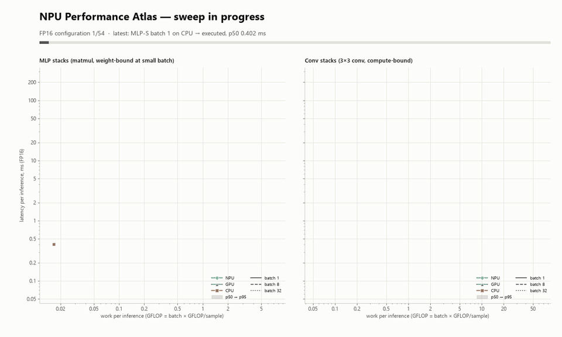

# NPU Performance Atlas

A rigorous, reproducible benchmark sweep that maps **where the Intel AI Boost NPU beats the CPU and iGPU on this
Panther Lake laptop, and where it does not**, rendered as one multi-panel dashboard.



Static, full-resolution dashboard: [`media/perf_atlas.png`](../../media/perf_atlas.png).

## What it measures

Synthetic OpenVINO models are built in-process with `ov.opset13` from seeded random weights (`rng 2026`). There are
no downloads.

| Model | Structure | GFLOP / sample | Params |
|---|---|---|---|
| MLP-S | 4 residual blocks, D=512, D→4D→D, ReLU | 0.017 | 8.4 M |
| MLP-M | 4 blocks, D=1024 | 0.067 | 33.6 M |
| MLP-L | 3 blocks, D=2048 | 0.201 | 100.7 M |
| CONV-XS | 3×3 stride-2 stem + 3 × conv3×3 (C=32) @ 64², global mean | 0.058 | 0.03 M |
| CONV-S | stem + 4 × conv3×3 (C=32) @ 128² | 0.30 | 0.04 M |
| CONV-M | stem + 6 × conv3×3 (C=64) @ 128² | 1.81 | 0.22 M |

Each model runs at **batch 1, 8 and 32**, so the work per inference spans about 0.017 to 58 GFLOP. The MLPs are
weight-bandwidth-bound at small batch; the conv stacks are compute-bound. Each model also runs in three weight formats:

| Label | What is actually tested |
|---|---|
| **FP32** | fp32 constants. CPU and GPU are compiled with `INFERENCE_PRECISION_HINT=f32`. The NPU has no f32 compute path, so it runs at its default (f16). The dashboard and JSON record the precision each device reports. |
| **FP16** | fp16 constants + `Convert` (the `compress_to_fp16` pattern), with `INFERENCE_PRECISION_HINT=f16` on every device. On this CPU, f16 is honoured (it reports `float16`). |
| **INT8** | **Weight-only** symmetric per-output-channel int8 (`i8 const → Convert → Multiply(scale)`). This is the same decompression pattern NNCF's `INT8_SYM` weight compression emits, built by hand. Activations run in f16. There is **no activation quantization / FakeQuantize / calibration**, so this is *not* a full-INT8 model. NNCF was not used because installing it would have downgraded the venv's numpy. |

For every (model, batch, precision, device), the JSON records:

* `compile_s`: wall time of `core.compile_model` (`PERFORMANCE_HINT=LATENCY`).
* `first_infer_ms`: the first `infer()` after compile.
* `median_ms`, `p95_ms`, `min_ms`, `max_ms` from `ovutil.time_request`: a prepared `InferRequest` with its input
  tensor bound once. The timed region is `request.infer()` only. Output copy and comparison happen outside it.
  The number of runs adapts to about 1 s per config (10 to 200 runs, plus 3 warm-up).
* `infer_per_s`, `samples_per_s`, `gflops_effective` (= analytic GFLOP per inference / p50).
* `execution_devices` (normalised list), `inference_precision` (as reported by the compiled model).
* Correctness: `rel_err = max|out − ref| / max|ref|` against a numpy float32 reference that uses the *effective*
  weights (fp16-rounded or dequantized). Tolerance is 2e-3 for f32 compute and 1.5e-2 for f16. `rel_err_vs_fp32` shows
  the extra error from the weight format itself. If a batched output fails, `batch_diagnosis` tests whether every
  sample simply repeats sample 0's result.
* `status`: `skipped` (device not enumerated), `failed` (compile/infer exception, with the error text),
  `failed_correctness` (ran but gave the wrong answer; no timing is reported), or `executed`. A device is **never**
  silently replaced by another.

Async throughput mode runs on the largest configs. It compiles with `PERFORMANCE_HINT=THROUGHPUT`, drives an
`AsyncInferQueue` with the device's `OPTIMAL_NUMBER_OF_INFER_REQUESTS` for about 2 s, and reports samples/s.

## How to run

```powershell
.venv\Scripts\python.exe -m examples.perf_atlas --quick          # 3 models x batch 1,8 (~1.5 min)
.venv\Scripts\python.exe -m examples.perf_atlas                  # full grid, 162 configs (~10-15 min)
.venv\Scripts\python.exe -m examples.perf_atlas --devices NPU CPU
.venv\Scripts\python.exe -m examples.perf_atlas --plot-only benchmarks/results/perf_atlas.json   # re-render only
```

Results go to `benchmarks/results/perf_atlas.json` (`perf_atlas_quick.json` with `--quick`; override with `--output`).
Media is named after the JSON stem: `media/<stem>.png`, `media/<stem>.gif` (< 5 MB), and `media/mp4/<stem>.mp4`
(gitignored). Progress lines go to stderr, and a JSON summary (status counts, NPU-vs-CPU/GPU win counts, peak
GFLOP/s, async rows, crossovers) goes to stdout. Requires `matplotlib` in the venv.

## How to read the dashboard

1. **Latency vs work (MLP | Conv)**. Log-log axes: x is GFLOP per inference and y is latency in ms. There is one line
   per device (colour plus marker shape) and batch size (solid = 1, dashed = 8, dotted = 32). Each line shows p50,
   and the shaded band runs from p50 to p95. Black circles mark where the NPU's line crosses the CPU or GPU line,
   interpolated in log-log space between model sizes. The box in the top-left summarises each crossover in words.
   A line that stops early means the remaining configurations failed or were wrong (see panel 7).
2. **NPU speed-up vs CPU** and 3. **vs GPU** (FP16). Each cell is other-device p50 / NPU p50. Blue cells are NPU
   wins and red cells are losses, with a log-symmetric scale centred on 1×. Hatched cells name the device that
   failed or gave a wrong answer.
4. **Peak sustained compute**. The best effective GFLOP/s each device reached at each precision, in sync latency mode.
5. **Compile cost**. Median `compile_model` time per model (log scale). The NPU pays a much larger one-off compile.
   Use `CACHE_DIR` in real apps.
6. **Throughput: async queue vs sync**. Bars show async samples/s; the black tick is the single-request sync rate
   for the same config. The gap shows what pipelining buys on each device.
7. **Compatibility & correctness**. One cell per device × precision × model, showing the worst status over batch
   sizes and the count executed. ✓ executed and correct, ≠ ran but gave wrong output, ✗ failed.

## Methodology caveats

* **Synthetic models, not real networks.** Dense MLP and 3×3 conv stacks show the regimes (overhead-bound,
  bandwidth-bound, compute-bound), but real models add attention, norms, odd shapes and data layout changes that each
  device handles differently.
* **Effective GFLOP/s is not TOPS.** It is analytic multiply-accumulate count / measured latency, including dispatch
  overhead. Vendor TOPS figures are int8 peak numbers under ideal tiling.
* **Power state matters a lot.** Plugged-in vs battery, the Windows power mode, and thermals change CPU/GPU clocks
  and NPU behaviour. The JSON records `meta.power`. Compare runs only under the same conditions.
* **Concurrency.** Other processes using the NPU or GPU (another model test, a browser using the iGPU) perturb the
  timings, the p95 in particular. For publishable numbers, run on an idle machine.
* **Sync latency mode** measures one request at a time. Panel 6 shows how differently the devices scale once
  requests are pipelined.
* INT8 here is weight-only (see above). A properly calibrated full-INT8 model (NNCF `quantize`) would exercise the
  NPU's int8 MAC arrays, which this sweep does not.

## Results on this machine

First full run: 2026-11-11, Core Ultra 5 322, OpenVINO 2026.4.1, on AC power. Another process was using the NPU
for model tests at the same time, so treat the absolute numbers as provisional. The sweep took 352 s plus about
50 s of rendering.

* **NPU wins at batch 1 and batch 32.** At FP16 batch 1, MLP-L runs in 3.4 ms on the NPU, against 6.2 ms on the
  GPU and 16.0 ms on the CPU. At batch 32, MLP-L takes 4.0 ms on the NPU versus 9.1 ms on the GPU, and CONV-M takes
  5.3 ms versus 9.3 ms on the GPU and 415 ms on the CPU. That CONV-M result is about 11 effective TFLOP/s, the highest
  of any device. Taking all precisions together, the NPU beat the CPU in 41 of 45 comparable configs and the GPU in
  28 of 45.
* **NPU loses badly at batch 8.** At FP16 batch 8 it is 0.19-0.28× the GPU's speed on every MLP and slower than the
  CPU on MLP-M and MLP-L. MLP-L takes 24.6 ms at batch 8 but 4.0 ms at batch 32, so batch 8 is a pathological shape
  for the NPU compiler.
* **The iGPU wins small convs at batch 1.** CONV-XS and CONV-S run at 0.89-0.93× NPU speed relative to the GPU, i.e.
  the GPU is slightly faster. The GPU also wins MLP-S and every batch-8 config.
* **Correctness bug: NPU batched convs at batch 2-8 return sample 0's result for every element.** Batch ≥ 12 is
  correct. This was confirmed by scanning batch sizes; `batch_diagnosis` in the JSON records it. Those cells are shown
  as "wrong output" and are not timed. The MLPs are unaffected.
* **INT8 weight-only compression helps the bandwidth-bound MLP at batch 1.** MLP-L takes 1.9 ms on the NPU in INT8
  versus 3.4 ms in FP16, and async throughput goes from 374 to 740 samples/s.
* **Compile time is the NPU's cost.** Median compile is 0.63 s on the NPU, with a maximum of 14.5 s for MLP-L. The
  GPU's median is 0.42 s and the CPU's is 0.06 s.
* **CPU f16 is slower than f32** on this chip for the MLPs (MLP-L batch 1: 16.0 ms in f16 vs 9.1 ms in f32), even
  though the CPU accepts the f16 hint.
