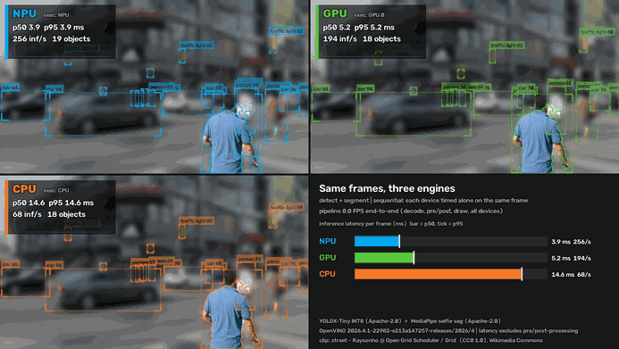

# Live vision side-by-side: NPU vs GPU vs CPU

The demo feeds the same video frames to three OpenVINO pipelines, one each on the **Intel AI Boost NPU**, the
**Xe3 iGPU** and the **CPU**, and draws the results next to each other. Each panel shows that device's own
object detections and its person segmentation (the background is softly blurred and dimmed, and the mask
outline is drawn in the device colour). A badge in each panel shows the measured inference latency
(p50 / p95, inferences per second, and a latency sparkline on a scale shared by all three panels), plus the
`EXECUTION_DEVICES` that OpenVINO reports. The fourth panel compares the latencies directly and shows the
end-to-end pipeline FPS.



## Run

```powershell
# live window (q / Esc quits), default street clip, NPU GPU CPU, detect + segment
.venv\Scripts\python.exe -m examples.vision_side_by_side

# other clips / tasks / devices
.venv\Scripts\python.exe -m examples.vision_side_by_side --source person --task segment
.venv\Scripts\python.exe -m examples.vision_side_by_side --source drive --task detect --devices NPU CPU

# all devices at once instead of one after another
.venv\Scripts\python.exe -m examples.vision_side_by_side --concurrent

# headless recording -> media/vision_side_by_side.gif (< 5 MB) + media/mp4/vision_side_by_side.mp4
.venv\Scripts\python.exe -m examples.vision_side_by_side --no-display --record --duration 15

# webcam (index 0). Live only: nothing is recorded unless you pass --record, which prints a warning.
.venv\Scripts\python.exe -m examples.vision_side_by_side --source 0
```

| Flag | Meaning |
|---|---|
| `--source` | Clip name (`street`, `person`, `forest`, `drive`; see `examples/common/clips.py`), a video file path, or a webcam index. Clips download on first use. |
| `--devices` | Default `NPU GPU CPU`. A device that fails to compile is shown as failed. Nothing falls back to another device. |
| `--task` | `detect`, `segment` or `both` (default). |
| `--concurrent` | Run all devices at the same time (see Methodology). |
| `--record`, `--duration` | Record a GIF and an MP4. The duration defaults to 15 s when recording. |
| `--no-display` | Headless mode. Without `--duration` it does a single pass over the clip. |
| `--output` | Results JSON (default `benchmarks/results/vision_side_by_side.json`). |
| `--conf` | Detection score threshold (default 0.35). |
| `--snapshot` | Also save the last composite frame as a PNG. |

The JSON records the per-device and per-model latency stats (`median_ms`, `p95_ms`, min, max), per-frame
totals, `compile_s`, `EXECUTION_DEVICES`, frame count, wall time, pipeline FPS, OpenVINO version, device
names, and the clip's name, licence and attribution.

## Methodology and caveats

* **Separate requests per device.** Every device compiles its own copy of each model
  (`PERFORMANCE_HINT=LATENCY`, static input shapes) and has its own `InferRequest`.
* **Default timing is sequential.** On every frame, each device runs alone on the same pre-processed input,
  one device after another. The device order rotates every frame so no device always goes first. The frame
  latency is detection + segmentation `infer()` time. The panel states the mode on screen.
* **`--concurrent`** starts every device at once (one `AsyncInferQueue(jobs=1)` per device and model).
  Latency runs from `start_async` to the completion callback. The devices then compete for memory bandwidth
  and host CPU time, and the CPU plugin's threads also slow the host-side dispatch for the NPU and GPU. This
  mode is more realistic for "everything at once" workloads, and its numbers are noisier.
* **The timings exclude** decode, pre-processing (done once and shared), NMS and mask post-processing, and
  drawing. The **pipeline FPS** shown in the stats panel and the JSON is the end-to-end loop rate for all
  devices together. In sequential mode it is bounded by the sum of all the devices' latencies plus drawing.
* The on-screen p50/p95 use the last 120 frames. The JSON uses every frame after 5 untimed warm-up runs.
* This is a single laptop, the timings are wall-clock, and the power state is not controlled: plugged in or
  on battery, other processes, and thermals all move the numbers. Treat them as indicative, and use
  `examples/perf_atlas` for controlled sweeps.
* All three devices run the same INT8 / FP32 model files. Their outputs differ slightly (scores, a box here
  and there) because of device-specific precision. That is expected, and the demo shows it as it is.

## Results on this machine

Clean run, 2026-11-12, NPU driver 32.0.100.5540 (graphics driver 32.0.101.9175, OpenVINO 2026.4.1): street clip,
sequential mode, 324 frames, idle laptop on AC power. Median (p95) per-frame `infer()` time, excluding decode,
pre/post-processing and drawing.

| Device | Detect (YOLOX-Tiny INT8, 416) | Segment (selfie, 256) | Frame (detect + segment) | Frames/s at median |
|---|---|---|---|---|
| **NPU** | **2.29 ms** (2.47) | **0.84 ms** (0.94) | **3.13 ms** (3.38) | **319** |
| GPU | 4.23 ms (4.35) | 1.08 ms (1.21) | 5.33 ms (5.52) | 188 |
| CPU | 11.88 ms (13.10) | 2.62 ms (2.95) | 14.48 ms (15.98) | 69 |

The NPU is 4.6x faster than the CPU and 1.7x faster than the GPU on the per-frame AI step. The end-to-end pipeline
rate for all three devices together was 21.6 FPS, which is bounded by the sum of the device latencies plus drawing.

## Models

| Task | Model | Licence | Pre/post-processing |
|---|---|---|---|
| Detection | [OpenVINO/yolox_tiny-int8-ov](https://huggingface.co/OpenVINO/yolox_tiny-int8-ov) (YOLOX-Tiny, INT8 PTQ, COCO-80) | Apache-2.0 | 416×416 letterbox (pad 114), ImageNet mean/std on 0–255. The IR does **not** apply NMS, so the host runs class-aware NMS (`cv2.dnn.NMSBoxes`, IoU 0.5). |
| Segmentation | [onnx-community/mediapipe_selfie_segmentation](https://huggingface.co/onnx-community/mediapipe_selfie_segmentation) | Apache-2.0 | 256×256 RGB / 255, NCHW. The alpha mask is upsampled and smoothstep-feathered. |

The selfie segmenter is built for people close to the camera. On the street clip it picks out the nearest
pedestrians and leaves distant ones in the softened background, which is why the background effect is kept
subtle. Use `--source person --task segment` to see it on its intended input.

## Footage

Each clip comes from Wikimedia Commons with a verified CC0 or public-domain licence. Full details are in
[`assets/CLIPS_ATTRIBUTION.md`](../../assets/CLIPS_ATTRIBUTION.md).

* `street` (default): "DiagonalCrosswalkYongeDundas.webm" by Raysonho @ Open Grid Scheduler / Grid Engine, CC0 1.0.
* `person`: "Video Blog- CBP Super Bowl LII Countdown to Kickoff - Day 4.webm" by Mani Albrecht, U.S. CBP. Public domain (U.S. federal government work).
* `forest`: "Fern Canyon in Prairie Creek Redwoods State Park.webm" by Thomas Farley, CC0 1.0.
* `drive`: "Dashcam Recording (urban).ogv" by Fernost, CC0 1.0.
